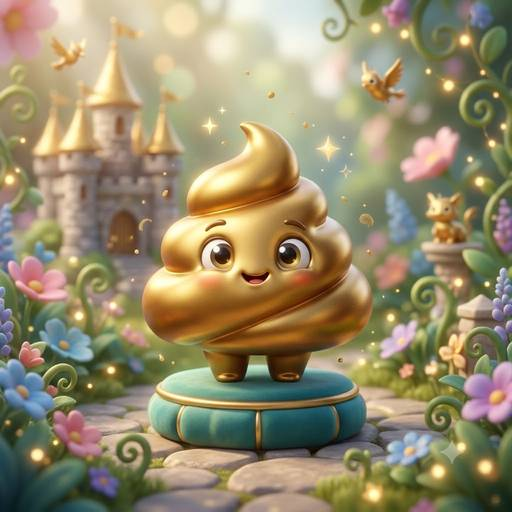
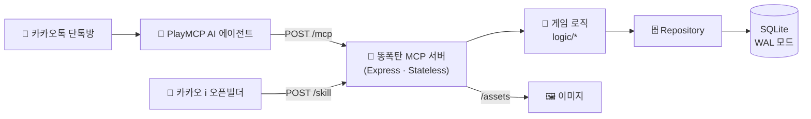

<div align="center">


# 💩 똥폭탄 · Ddongpoktan

### 카카오톡 단톡방에서 벌어지는 실시간 똥 던지기 난투 게임


<a href="https://github.com/Moomooti/ddongpoktan-mcp/actions/workflows/ci.yml"></a>
<br/><br/>


</div>

<br/>

## 💡 어떤 게임인가요?

단톡방 친구에게 **똥을 던지세요.** 💩
맞은 사람의 변기에는 똥이 쌓이고, 꽉 차면 **불운**이 찾아와 코인을 벌 수 없어요.
변기를 내리고, 강화하고, 반격하면서 **28종 똥 도감**과 **10종 변기 스킨**을 모아보세요.

카카오 **PlayMCP 공모전 「Agentic Player 10」** 출품작으로, AI 에이전트가 MCP 툴을 호출해 게임을 진행하는 **MCP 서버**예요.

<br/>

## 🎲 던질 때마다 랜덤! 똥 등급

| | 등급 | 확률 | 효과 |
|:-:|---|:-:|---|
|  | **일반 똥** (24종) | 75% | 상대 변기에 똥 +1 |
|  | 🌈 **무지개 똥** | 12% | 던진 사람·맞은 사람 **둘 다 행운** + 맞은 사람 코인 보너스 |
|  | 💣 **폭탄 똥** | 8% | **라운드 종료!** 방 전체 변기 초기화 |
|  | 👑 **황금 똥** | 4% | 방 전원에게서 **세금 강제 징수** |
|  | 💎 **다이아 똥** | 1% | 방 전원 코인의 **30% 압류** |

> 일반 똥 24종은 *"알람 5번 끄고 지각한 똥"*, *"카톡 1이 안 없어져서 초조한 똥"*, *"급똥인데 엘베가 만원인 똥"* 처럼 하나하나 이름이 있어요.

<br/>

## 🚽 변기 강화

코인을 써서 변기를 강화하면 **변기 내리기 성공률**이 올라가요. Lv.3 이상을 노리다가 **2번 연속 실패하면 Lv.0으로 초기화**돼요.

<table>
<tr>
<td align="center"><br/><b>Lv.0</b><br/>낡은 변기</td>
<td align="center"><br/><b>Lv.1</b><br/>새하얀 변기</td>
<td align="center"><br/><b>Lv.2</b><br/>스테인리스</td>
<td align="center"><br/><b>Lv.3</b><br/>대리석</td>
<td align="center"><br/><b>Lv.4</b><br/>나노테크</td>
<td align="center"><br/><b>Lv.5</b><br/>옥좌 👑</td>
</tr>
<tr>
<td align="center">60%</td><td align="center">65%</td><td align="center">70%</td><td align="center">75%</td><td align="center">80%</td><td align="center">85%</td>
</tr>
</table>

<sub>아래 줄은 레벨별 변기 내리기 성공률이에요. 이 밖에 무지개 · 황금 · 다이아 · 올스타(도감 완성) 특별 스킨이 있어요.</sub>

<br/>

## 🛠️ MCP 툴 (8개)

| 툴 | 설명 |
|---|---|
| `throw_poop` | 💩 똥 던지기 (대상을 비우면 마지막으로 나를 공격한 사람에게 **복수**) |
| `flush_toilet` | 🚽 변기 내리기 (확률, 실패하면 똥 +1~3) |
| `enhance_toilet` | ⬆️ 변기 강화 (Lv.0 → 5) |
| `use_bidet` | 🚿 비데로 불운 해제 |
| `use_perfume` | 🌸 향수로 변기 **확정** 청소 (비싸지만 100%) |
| `check_status` | 📊 내 변기 · 레벨 · 운세 · 코인 한 번에 보기 |
| `check_dex` | 📖 똥 도감 (28종) |
| `select_skin` | 🎨 변기 스킨 보기 · 장착 |

<br/>

## 🤖 에이전트가 쓰기 쉬운 MCP 서버

이 서버의 진짜 사용자는 사람이 아니라 **툴을 호출하는 AI 에이전트**예요. 그래서 "사람에게 보기 좋은가"보다 **"에이전트가 헷갈리지 않고, 실패하지 않는가"**를 기준으로 설계했어요.

### 1. 응답은 작은 텍스트 하나, 이미지는 URL로

처음에는 똥 그림을 base64 이미지 블록으로 툴 응답에 함께 실었어요. 그런데 실제 단톡방 테스트에서 `throw_poop`을 부르자마자 PlayMCP가 **"일시적 오류"**를 냈어요.

| 단계 | 가설 | 한 일 | 결과 |
|:-:|---|---|---|
| 1 | 이미지가 너무 크다 | 전체 이미지 512×512 · JPEG 70으로 재인코딩, **26MB → 2.9MB** (장당 base64 100KB 미만) | ❌ 같은 오류 |
| 2 | 크기가 아니라 **구조**의 문제다. 답변 생성 단계가 인라인 base64를 다루지 못한다 | `/assets`로 이미지를 직접 서빙하고, 툴 응답에는 **텍스트 + 이미지 URL**만 담기 | ✅ 해결 |

> 1단계에서 확장자는 `.png`인데 실제로는 JPEG인 파일도 함께 찾아 고쳤어요.

이 결정은 [`tests/mcpContract.test.ts`](tests/mcpContract.test.ts)로 고정했어요. 모든 툴 응답이 **텍스트 블록 1개 · 2,000자 미만 · base64 없음**인지, 응답 속 이미지 URL이 **실제로 존재하는 파일**을 가리키는지 확인해요. 누가 이미지 블록을 다시 넣으면 테스트가 바로 실패해요.

### 2. 같은 그림도 받는 쪽에 맞게

| 받는 쪽 | 형식 | 이유 |
|---|---|---|
| PlayMCP 에이전트 (`/mcp`) | 텍스트 안에 이미지 URL | 에이전트가 읽고 답변을 만드는 입력이라 단순할수록 안전 |
| 카카오 i 오픈빌더 (`/skill`) | `simpleImage` 이미지 블록 | 채팅 화면이 이미지를 직접 그려 주는 형식이라 정식 블록이 자연스러움 |

### 3. 툴 설명이 곧 에이전트용 문서

- 모든 파라미터에 zod `.describe()`로 설명을 달았어요. 예를 들어 `room_code`는 *"카카오톡 채팅방 ID가 아니라 플레이어끼리 정한 단어"*라고 적어서, 에이전트가 엉뚱한 값을 넣지 않게 했어요.
- `readOnlyHint` 같은 annotation으로 조회용 툴(`check_status`, `check_dex`)과 상태를 바꾸는 툴을 구분했어요.
- 확률과 효과(일반 75% · 무지개 12% …)를 툴 설명에 직접 적어서, 에이전트가 결과를 설명할 때 추측하지 않게 했어요.

### 4. 실수해도 대화가 이어지게

- `target_nickname`을 비우면 오류 대신 **마지막으로 나를 공격한 사람에게 복수**해요. 에이전트가 대상을 못 뽑아도 게임이 자연스럽게 진행돼요.
- 그래도 대상이 없으면 오류가 아니라 *"누구에게 던질지 말해주세요"* 같은 **안내 문장**을 돌려줘서, 에이전트가 사용자에게 그대로 되물을 수 있어요.
- 형식이 틀린 입력(빈 `room_code` 등)은 스키마 검증에서 막혀 에이전트가 볼 수 있는 오류로 돌아가요. 카카오 `/skill` 요청 본문도 zod로 검증해서, 이상한 요청이 와도 서버가 죽지 않고 도움말로 답해요.

<br/>

## ⚙️ 구조



- **Stateless 설계**: 요청마다 새 MCP 서버를 만들고, 게임 상태는 전부 SQLite에 저장해요.
- **Repository 패턴**: 나중에 서버가 여러 대로 늘어나도 Postgres로 쉽게 갈아탈 수 있게 DB 접근을 한 겹 감쌌어요.
- **방별 독립 상태**: 같은 사람이라도 단톡방마다 코인 · 변기 · 도감이 따로 관리돼요.

<br/>

## 🧪 테스트와 품질 관리

```bash
npm run check   # 타입 검사 → 린트 → 테스트 → 빌드를 한 번에
npm run smoke   # 빌드된 서버를 띄워 HTTP로 tools/list · tools/call · 이미지 URL까지 확인
```

| 무엇을 | 어떻게 | 파일 |
|---|---|---|
| **에이전트 계약** | 실제 MCP 클라이언트로 서버에 붙어서, 툴 8개 · 설명 · 파라미터 설명 · 응답 형식(텍스트 1개, base64 없음, 크기 제한) · 이미지 URL 유효성 확인 | [`tests/mcpContract.test.ts`](tests/mcpContract.test.ts) |
| **설계 문서 ↔ 코드** | `DESIGN.md`의 툴 명세 표(입력 · annotation)와 강화 표(비용 · 확률)를 직접 읽어서, 실행 중인 서버 · `constants.ts`와 다르면 실패 | [`tests/designSpec.test.ts`](tests/designSpec.test.ts) |
| **확률 로직** | `Math.random()`을 원하는 값으로 고정해서, 등급 경계값(0.75 · 0.87 · 0.95 · 0.99)과 강화 · 내리기 성공/실패를 운에 맡기지 않고 검증 | [`tests/species.test.ts`](tests/species.test.ts), [`tests/toilet.test.ts`](tests/toilet.test.ts) |
| **게임 규칙** | 복수 · 도감 · 무지개 행운 · 폭탄 라운드 종료 · 황금 세금 · 다이아 압류 | [`tests/throwPoop.test.ts`](tests/throwPoop.test.ts) |
| **데이터 ↔ 이미지 일치** | 똥 28종 · 스킨 10종 × 3단계 이미지가 모두 있는지, 장당 150KB 이하인지 | [`tests/species.test.ts`](tests/species.test.ts) |
| **카카오 연동** | 깨진 요청에도 카카오 응답 형식을 지키는지, 이미지를 정식 블록으로 보내는지 | [`tests/skill.test.ts`](tests/skill.test.ts) |

- 테스트마다 **메모리 SQLite**를 써서 실제 DB 파일을 건드리지 않고, 테스트끼리 상태가 섞이지 않아요.
- ESLint는 `typescript-eslint`의 **타입 정보 기반 규칙**(`recommendedTypeChecked`)을 테스트 코드까지 적용해요. 처리하지 않은 Promise, `any` 값 접근 같은 실수를 잡아요.
- [GitHub Actions](.github/workflows/ci.yml)가 push · PR마다 **Node 20 · 22**에서 위 과정을 모두 돌리고, Docker 이미지 빌드도 확인해요.
- **의존성 관리**: CI가 서버에 실제로 실리는 패키지(`--omit=dev`)의 high 이상 취약점을 검사하고, [Dependabot](.github/dependabot.yml)이 매주 월요일 업데이트 PR을 올려요. 개발 도구는 한 PR로 묶어서 리뷰 부담을 줄였어요.
  - 2026-11: MCP SDK(요청 본문 크기 제한 없음 등), express 의존성(proxy-addr IP 위조, body-parser DoS), zod 취약점을 업데이트로 해결해서 런타임 취약점 **9개 → 0개**. 테스트 106개로 동작이 그대로인지 확인했어요.

<br/>

## 📁 프로젝트 구조

```
ddongpoktan-mcp/
├── src/
│   ├── index.ts          # Express 서버 · /mcp · /skill · /assets 엔드포인트
│   ├── server.ts         # MCP 서버 생성
│   ├── tools.ts          # MCP 툴 8개 등록
│   ├── skill.ts          # 카카오 i 오픈빌더 스킬 연동
│   ├── logic/            # 던지기 · 내리기 · 강화 · 비데 · 향수 · 스킨 · 상태
│   ├── repository.ts     # DB 접근 계층
│   ├── db.ts             # SQLite 스키마 · 초기 데이터
│   ├── species.ts        # 똥 28종 정의 · 등급 확률
│   ├── constants.ts      # 확률 · 코인 · 비용 밸런스 값
│   └── formatters.ts     # 채팅용 응답 문구
├── assets/
│   ├── species/          # 똥 도감 이미지 28장
│   ├── skins/            # 변기 스킨 10종 × 3단계 (빈 변기 · 쌓임 · 꽉 참)
│   └── effects/          # 비데 · 내리기 실패 · 향수 연출
├── tests/                # 에이전트 계약 · 설계 문서 대조 · 게임 규칙 · 확률 · 이미지 · 카카오 연동
├── scripts/smoke.sh      # 빌드된 서버를 HTTP로 호출하는 스모크 테스트
├── .github/workflows/    # CI (타입 검사 · 린트 · 테스트 · 빌드 · 스모크 · Docker)
├── DESIGN.md             # 상세 설계 문서 (데이터 모델 · 상태머신 · 툴 명세)
└── Dockerfile
```

<br/>

## 🚀 실행 방법

```bash
npm ci
npm run dev          # 개발 서버 → http://localhost:3000/mcp
npm run check        # 타입 검사 · 린트 · 테스트 · 빌드
```

```bash
# 배포용
npm run build && npm start

# Docker
docker build -t ddongpoktan-mcp .
docker run -p 3000:3000 -v $(pwd)/data:/app/data ddongpoktan-mcp
```

```bash
# MCP 툴 목록 확인 (서버 실행 중)
npm run inspector
```

<br/>

## 📖 설계 문서

데이터 모델, 상태머신, 확률 로직, PlayMCP 플랫폼 조사 내용은 [`DESIGN.md`](DESIGN.md)에 정리되어 있어요.

<br/>

<div align="center">

<br/>
<sub>옥좌라도 넘치면 대책 없어요 💩</sub>
</div>
