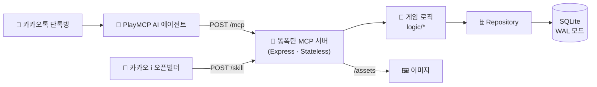

<div align="center">


# 💩 똥폭탄 · Ddongpoktan

### 카카오톡 단톡방에서 벌어지는 실시간 똥 던지기 난투 게임


<br/><br/>


</div>

<br/>

## 💡 어떤 게임인가요?

단톡방 친구에게 **똥을 던지세요.** 💩
맞은 사람의 변기에는 똥이 쌓이고, 꽉 차면 **불운**이 찾아와 코인을 벌 수 없어요.
변기를 내리고, 강화하고, 반격하면서 **28종 똥 도감**과 **10종 변기 스킨**을 모아보세요.

카카오 **PlayMCP 공모전 「Agentic Player 10」** 출품작으로, AI 에이전트가 MCP 툴을 호출해 게임을 진행하는 **MCP 서버**예요.

<br/>

## 🎲 던질 때마다 랜덤! 똥 등급

| | 등급 | 확률 | 효과 |
|:-:|---|:-:|---|
|  | **일반 똥** (24종) | 75% | 상대 변기에 똥 +1 |
|  | 🌈 **무지개 똥** | 12% | 던진 사람·맞은 사람 **둘 다 행운** + 맞은 사람 코인 보너스 |
|  | 💣 **폭탄 똥** | 8% | **라운드 종료!** 방 전체 변기 초기화 |
|  | 👑 **황금 똥** | 4% | 방 전원에게서 **세금 강제 징수** |
|  | 💎 **다이아 똥** | 1% | 방 전원 코인의 **30% 압류** |

> 일반 똥 24종은 *"알람 5번 끄고 지각한 똥"*, *"카톡 1이 안 없어져서 초조한 똥"*, *"급똥인데 엘베가 만원인 똥"* 처럼 하나하나 이름이 있어요.

<br/>

## 🚽 변기 강화

코인을 써서 변기를 강화하면 **변기 내리기 성공률**이 올라가요. Lv.3부터는 실패 시 **Lv.0으로 초기화**될 수 있어요.

<table>
<tr>
<td align="center"><br/><b>Lv.0</b><br/>낡은 변기</td>
<td align="center"><br/><b>Lv.1</b><br/>새하얀 변기</td>
<td align="center"><br/><b>Lv.2</b><br/>스테인리스</td>
<td align="center"><br/><b>Lv.3</b><br/>대리석</td>
<td align="center"><br/><b>Lv.4</b><br/>나노테크</td>
<td align="center"><br/><b>Lv.5</b><br/>옥좌 👑</td>
</tr>
<tr>
<td align="center">60%</td><td align="center">65%</td><td align="center">70%</td><td align="center">75%</td><td align="center">80%</td><td align="center">85%</td>
</tr>
</table>

<sub>아래 줄은 레벨별 변기 내리기 성공률이에요. 이 밖에 무지개 · 황금 · 다이아 · 올스타(도감 완성) 특별 스킨이 있어요.</sub>

<br/>

## 🛠️ MCP 툴 (8개)

| 툴 | 설명 |
|---|---|
| `throw_poop` | 💩 똥 던지기 (대상을 비우면 마지막으로 나를 공격한 사람에게 **복수**) |
| `flush_toilet` | 🚽 변기 내리기 (확률, 실패하면 똥 +1~3) |
| `enhance_toilet` | ⬆️ 변기 강화 (Lv.0 → 5) |
| `use_bidet` | 🚿 비데로 불운 해제 |
| `use_perfume` | 🌸 향수로 변기 **확정** 청소 (비싸지만 100%) |
| `check_status` | 📊 내 변기 · 레벨 · 운세 · 코인 한 번에 보기 |
| `check_dex` | 📖 똥 도감 (28종) |
| `select_skin` | 🎨 변기 스킨 보기 · 장착 |

<br/>

## ⚙️ 구조



- **Stateless 설계**: 요청마다 새 MCP 서버를 만들고, 게임 상태는 전부 SQLite에 저장해요.
- **Repository 패턴**: 나중에 서버가 여러 대로 늘어나도 Postgres로 쉽게 갈아탈 수 있게 DB 접근을 한 겹 감쌌어요.
- **방별 독립 상태**: 같은 사람이라도 단톡방마다 코인 · 변기 · 도감이 따로 관리돼요.

<br/>

## 📁 프로젝트 구조

```
ddongpoktan-mcp/
├── src/
│   ├── index.ts          # Express 서버 · /mcp · /skill · /assets 엔드포인트
│   ├── server.ts         # MCP 서버 생성
│   ├── tools.ts          # MCP 툴 8개 등록
│   ├── skill.ts          # 카카오 i 오픈빌더 스킬 연동
│   ├── logic/            # 던지기 · 내리기 · 강화 · 비데 · 향수 · 스킨 · 상태
│   ├── repository.ts     # DB 접근 계층
│   ├── db.ts             # SQLite 스키마 · 초기 데이터
│   ├── species.ts        # 똥 28종 정의 · 등급 확률
│   ├── constants.ts      # 확률 · 코인 · 비용 밸런스 값
│   └── formatters.ts     # 채팅용 응답 문구
├── assets/
│   ├── species/          # 똥 도감 이미지 28장
│   ├── skins/            # 변기 스킨 10종 × 3단계 (빈 변기 · 쌓임 · 꽉 참)
│   └── effects/          # 비데 · 내리기 실패 · 향수 연출
├── DESIGN.md             # 상세 설계 문서 (데이터 모델 · 상태머신 · 툴 명세)
└── Dockerfile
```

<br/>

## 🚀 실행 방법

```bash
npm install
npm run dev          # 개발 서버 → http://localhost:3000/mcp
```

```bash
# 배포용
npm run build && npm start

# Docker
docker build -t ddongpoktan-mcp .
docker run -p 3000:3000 -v $(pwd)/data:/app/data ddongpoktan-mcp
```

```bash
# MCP 툴 목록 확인 (서버 실행 중)
npm run inspector
```

<br/>

## 📖 설계 문서

데이터 모델, 상태머신, 확률 로직, PlayMCP 플랫폼 조사 내용은 [`DESIGN.md`](DESIGN.md)에 정리되어 있어요.

<br/>

<div align="center">

<br/>
<sub>옥좌라도 넘치면 대책 없어요 💩</sub>
</div>
